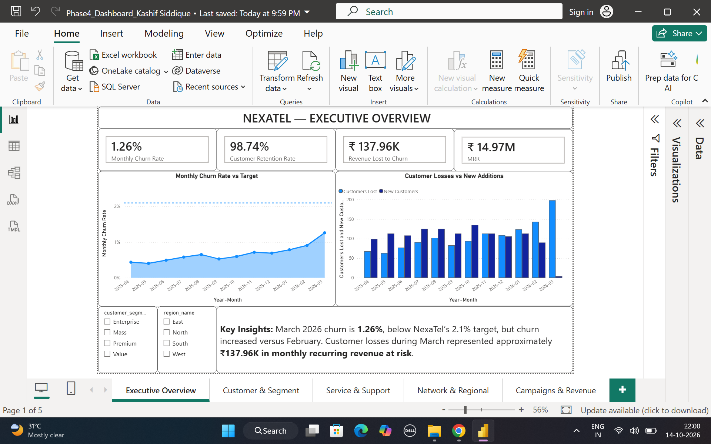
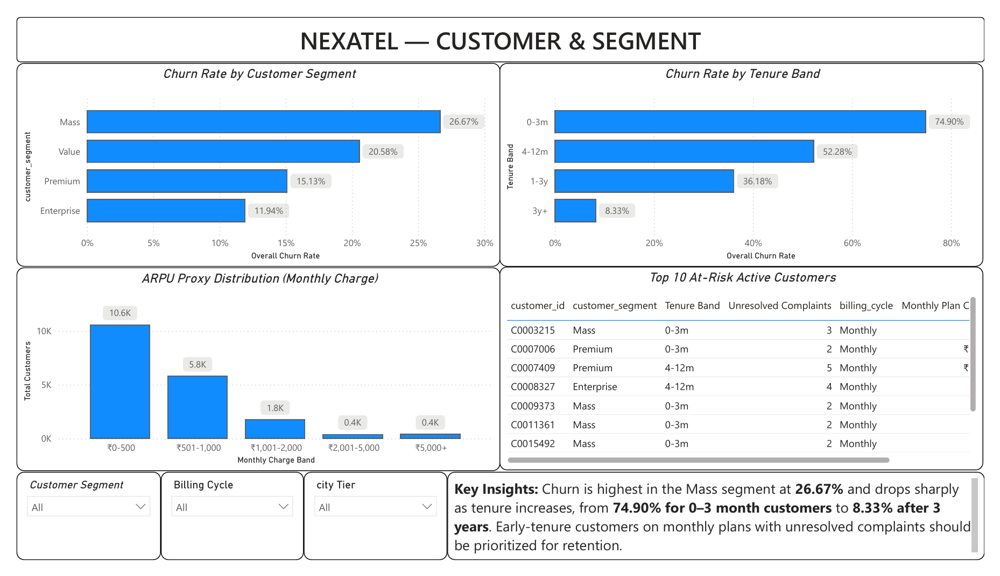
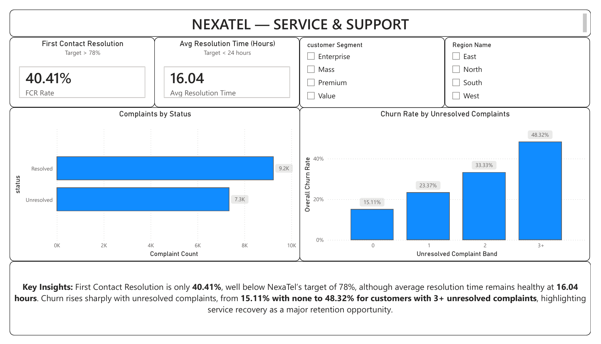
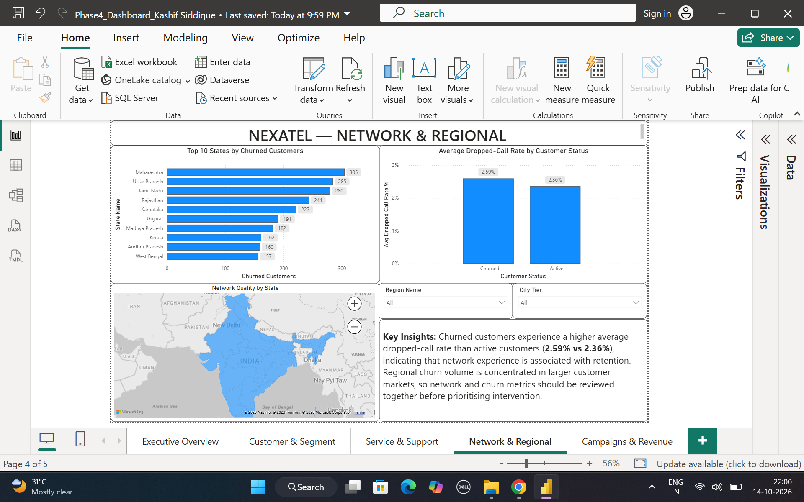
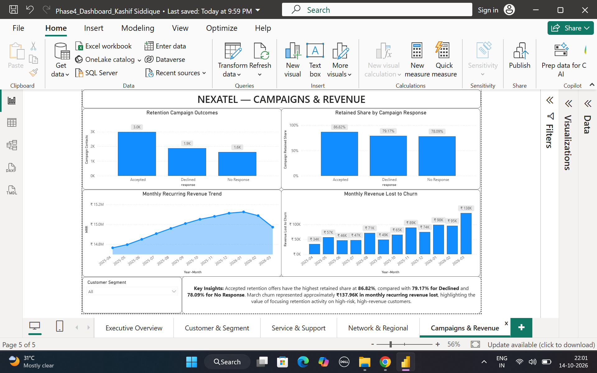

# NexaTel Customer Churn Analytics

End-to-end telecom customer churn analytics project using **Python, Pandas, Power BI, Power Query, and DAX**. The project covers data cleaning, exploratory analysis, KPI calculations, churn-driver analysis, interactive dashboarding, and management reporting focused on customer retention and revenue protection.

## Project Overview

NexaTel wanted to understand which customers are most likely to churn, what service and commercial factors are associated with churn, how much recurring revenue is at risk, and where retention teams should focus.

The project was completed in four phases:

1. **Data Cleaning & Quality Check**
2. **Exploratory Data Analysis**
3. **Churn KPI Calculations**
4. **Power BI Dashboard & Management Report**

## Key Business Results

| Metric | Result |
|---|---:|
| Monthly Churn Rate | **1.26%** |
| Customer Retention Rate | **98.74%** |
| Monthly Recurring Revenue | **₹14.97M** |
| Revenue Lost to March Churn | **₹137.96K** |
| First Contact Resolution | **40.41%** |
| Average Resolution Time | **16.04 hours** |
| Contract Renewal Rate | **57.15%** |

## Main Churn Patterns

- Customers in their first **0–3 months** had the highest churn rate at **74.90%**.
- **Monthly-plan** customers churned far more than annual-plan customers.
- Churn increased from **15.11%** with no unresolved complaints to **48.32%** for customers with **3+ unresolved complaints**.
- The **Mass** segment had the highest segment churn rate at **26.67%**.
- Churned customers had a higher average dropped-call rate (**2.59%**) than active customers (**2.36%**).
- Customers who **accepted retention offers** showed the highest retained share at **86.82%**.

## Power BI Dashboard

The final Power BI dashboard contains five management pages:

### 1. Executive Overview
- Monthly churn rate
- Retention rate
- Revenue at risk
- MRR
- Monthly churn trend vs target
- Customer losses vs new additions



### 2. Customer & Segment
- Churn by customer segment
- Churn by tenure band
- ARPU proxy distribution
- Top 10 at-risk active customers



### 3. Service & Support
- First Contact Resolution
- Average resolution time
- Complaints by status
- Churn vs unresolved complaints



### 4. Network & Regional
- Top states by churned customers
- Network quality by state
- Dropped-call rate by customer status



### 5. Campaigns & Revenue
- Retention campaign outcomes
- Retained share by response
- MRR trend
- Monthly revenue lost to churn



## Repository Structure

```text
NexaTel-Customer-Churn-Analytics/
│
├── README.md
├── .gitignore
│
├── notebooks/
│   ├── Phase1_DataCleaning_KashifSiddique.ipynb
│   ├── Phase2_EDA_KashifSiddique.ipynb
│   └── Phase3_KPIs_KashifSiddique.ipynb
│
├── dashboard/
│   └── Phase4_Dashboard_KashifSiddique.pbix
│
├── report/
│   ├── Phase4_Report_KashifSiddique.docx
│   └── Phase4_Report_KashifSiddique.pdf
│
└── images/
    ├── 01_Executive_Overview.png
    ├── 02_Customer_Segment.png
    ├── 03_Service_Support.png
    ├── 04_Network_Regional.png
    └── 05_Campaigns_Revenue.png
```

## Tools Used

- **Python:** Pandas, NumPy, Matplotlib
- **Jupyter Notebook**
- **Power BI**
- **DAX**
- **Power Query**
- **Git & GitHub**

## Data Quality Work

Phase 1 included:

- Profiling all 24 source datasets
- Missing-value analysis
- Duplicate checks
- Date and numeric validation
- Outlier checks
- Referential-integrity checks
- Customer, billing, payment, subscription, complaint, and usage-specific validation
- Comparison with the supplied data-quality issue log
- Post-cleaning validation and cleaned-data export

## Management Recommendations

1. Prioritize customers in their first 90 days, particularly monthly-plan customers.
2. Escalate customers with multiple unresolved complaints into a dedicated retention queue.
3. Improve First Contact Resolution, which is well below target.
4. Strengthen contract-renewal outreach and test annual-plan conversion incentives.
5. Combine network-quality monitoring with churn risk in high-volume states.

## Notes

The raw source datasets are not included in this repository. The repository focuses on the analysis workflow, notebooks, dashboard outputs, and management reporting.

## Author

**Kashif Siddique**  
Data Analytics Portfolio Project
